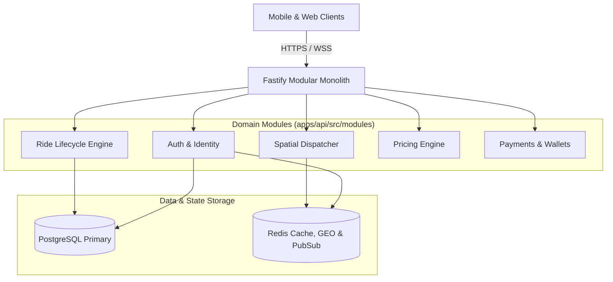
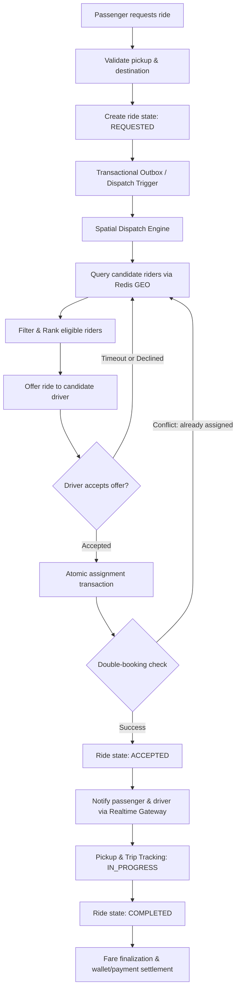

# ZYVO System Architecture & Concurrency Blueprint

This document details the architectural foundation, high-concurrency ride lifecycle, real-time spatial dispatching, and data tier strategy powering the **ZYVO** ride-hailing backend.

---

## 1. Architectural Paradigm: Modular Monolith

ZYVO is built as an evolutionary **Modular Monolith**. It runs as a single deployable Fastify application (`apps/api`) while maintaining strict boundaries across domain modules to prevent tight coupling.



### Core Tenets:
- **Single Deployable Unit**: Zero inter-service network hops or RPC serialization overhead for internal transactions.
- **Strict Boundary Decoupling**: Modules communicate via typed service interfaces or transactional domain events, avoiding direct cross-module database mutations.
- **Future Extraction Readiness**: High-throughput domains (such as Real-Time Dispatch and Pricing) are designed so they can be isolated into dedicated microservices when throughput requirements dictate.

---

## 2. The Concurrent Ride Lifecycle

The critical technical challenge in ride-hailing is managing concurrent, high-frequency state transitions without race conditions.



---

## 3. Real-Time Spatial Dispatch Pipeline

### A. Nearby Driver Matching (Redis GEO)
Querying millions of driver rows in PostgreSQL on every ride request causes catastrophic database CPU exhaustion. ZYVO delegates real-time spatial lookup to Redis:

1. **Active Location Ingestion**:
   - Active drivers periodically push lightweight GPS coordinates to the gateway.
   - Coordinates are saved into a Redis Geospatial Index (`GEOADD drivers:locations <lng> <lat> <driverId>`).
   - Driver availability statuses are maintained using key expiry and atomic bitmasks.
2. **Radial Candidate Discovery**:
   - Search nearby candidates using `GEOSEARCH drivers:locations FROMMEMBER / FROMLONLAT BYRADIUS <distance> km WITHCOORD WITHDIST`.
   - Results are filtered in-memory by vehicle category, driver compliance status, and active shift state.
3. **Multi-Factor Ranking**:
   - A bounded set of candidate drivers (e.g., top 10) is ranked using calculated ETA, historical acceptance rate, and directional heading.
4. **Targeted Dispatch Dispatching**:
   - Offers are dispatched sequentially or in batches with fixed response windows (e.g., 15 seconds).

---

## 4. Race-Safe Ride Assignment

A critical failure mode in ride dispatch is **double-booking** (e.g. two concurrent passenger requests assigned to the same driver, or multiple drivers accepting the same ride).

ZYVO prevents race conditions at the database level using atomic conditional updates and row-level locking:

```sql
-- Atomic conditional state change ensuring only one driver captures the ride
UPDATE rides
SET 
  driver_id = :candidateDriverId,
  status = 'ACCEPTED',
  updated_at = NOW()
WHERE id = :rideId
  AND status = 'REQUESTED'
  AND driver_id IS NULL;
```

If the rows affected count is `0`, the assignment transaction rolls back, and the driver offer loop continues to the next candidate without corrupting state.

---

## 5. High-Frequency Telemetry vs. Database Hygiene

Driver GPS updates occur every 2–4 seconds per active vehicle:

- **Hot Path (Real-Time Ingestion)**:
  - Updates flow directly into **Redis GEO** for dispatch and ephemeral driver markers on passenger maps.
  - Ephemeral pub/sub channels broadcast location deltas to assigned passengers.
- **Cold Path (Trip History & Billing)**:
  - Location pings are **not** written to PostgreSQL per second.
  - Waypoints are down-sampled or buffered, writing only trip start, milestone turns, pickup, and dropoff breadcrumbs to PostgreSQL.
  - Avoids write amplification and unnecessary table bloating.

---

## 6. Domain Event Outbox Architecture

To ensure consistency between database mutations and asynchronous events (e.g., push notifications, payment processing, fraud analytics), ZYVO utilizes the **Transactional Outbox Pattern**:

1. Business records and domain events are written within the **same** PostgreSQL transaction.
2. An asynchronous dispatcher polls or receives WAL notifications to emit events through Redis Pub/Sub.
3. Consumer workers process side-effects idempotently without risking partial failures during HTTP requests.